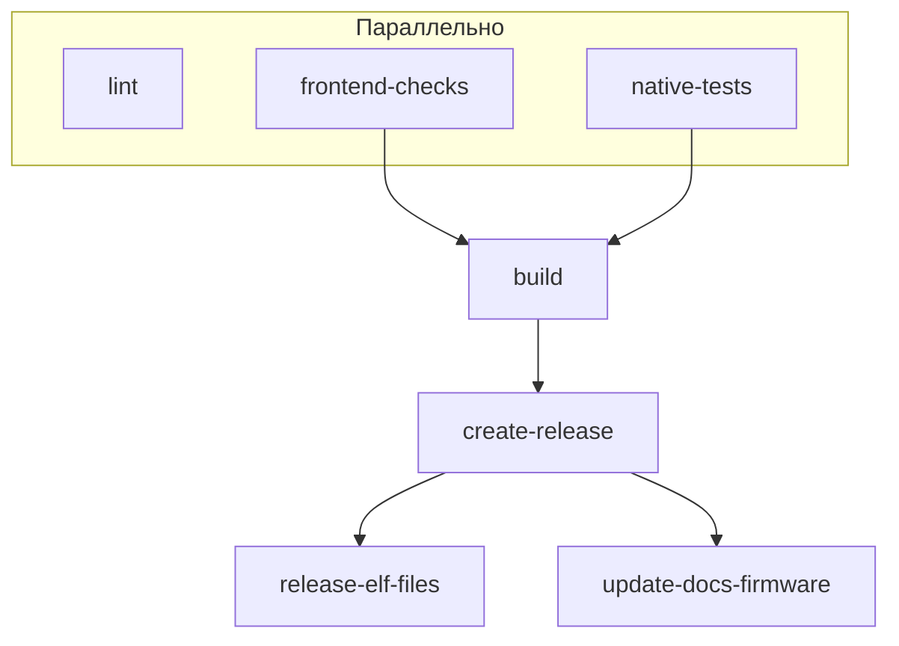

# Сборка прошивки

## Локальная сборка

```bash
pio run
```

Сборка по всем целям (8m, 8m-secure, 16m, 16m-secure):

```bash
pio run -e esp32-s3-devkitc-1-8m -e esp32-s3-devkitc-1-8m-secure -e esp32-s3-devkitc-1-16m -e esp32-s3-devkitc-1-16m-secure
```

## CORS: когда включать

CORS (Cross-Origin Resource Sharing) нужен только доверенному стороннему
браузерному клиенту — странице на другом origin, которой нужно читать `/rest/*`
устройства напрямую. Веб-интерфейс прошивки работает с того же origin, поэтому по
умолчанию CORS **выключен**: заголовок `Access-Control-Allow-Origin` разрешает
любой открытой в браузере странице обращаться к API устройства, и это ослабляет
защиту от вредоносных страниц. Обычные сборки CORS не включают.

Включение — осознанный выбор среды, править `platformio.ini` руками не нужно:

| Среда | База | CORS |
|-------|------|------|
| `esp32-s3-devkitc-1-8m-cors` | `esp32-s3-devkitc-1-8m` | включён |
| `esp32-s3-devkitc-1-8m-secure-cors` | `esp32-s3-devkitc-1-8m-secure` | включён |

```bash
pio run -e esp32-s3-devkitc-1-8m-cors
```

Среды объявлены через `extends` и добавляют ровно `-DENABLE_CORS`. Базовые
`build_flags` (включая `${factory_settings.build_flags}` и
`${features.build_flags}`) подставляются из родительской среды, поэтому остальные
флаги и поведение прошивки не меняются; в сборках без `-cors` кода CORS нет вовсе.

### Какие заголовки отдаются

При `ENABLE_CORS` заголовки добавляются к каждому ответу:

| Заголовок | Значение |
|-----------|----------|
| `Access-Control-Allow-Origin` | `CORS_ORIGIN` (по умолчанию `*`) |
| `Access-Control-Allow-Methods` | `GET, POST, PUT, DELETE, OPTIONS` |
| `Access-Control-Allow-Headers` | `Accept, Content-Type, Authorization` |
| `Access-Control-Allow-Credentials` | `true` только при явном `CORS_ORIGIN`; при `*` не отдаётся |

`Access-Control-Allow-Origin: *` и `Access-Control-Allow-Credentials: true`
несовместимы по Fetch-спеке — браузер отклоняет такой ответ. Поэтому при
дефолтном `*` credentials отключены. Клиенту с Bearer-токеном в заголовке
`Authorization` этого достаточно; cookies (или HTTP-auth) требуют явного origin:

```ini
; в build_flags своей среды, например вместо дефолтного "*"
-D CORS_ORIGIN=\"https://app.example\"
```

### Preflight и проверка

OPTIONS на `/rest/*` обрабатывается одним обработчиком: `204 No Content` без тела
и без аутентификации (preflight браузера не несёт `Authorization`, иначе он не
смог бы пройти). Заголовки CORS при этом добавляются как обычно. Проверка
preflight вручную:

```bash
curl -i -X OPTIONS http://DEVICE_IP/rest/oc/snapshot
```

Ожидается `HTTP/1.1 204 No Content` и заголовки `Access-Control-Allow-Origin`,
`Access-Control-Allow-Methods`, `Access-Control-Allow-Headers`. Обычный запрос:

```bash
curl -i http://DEVICE_IP/rest/oc/info -H "Authorization: Bearer TOKEN"
```

В его ответе должны быть те же CORS-заголовки.

!!! note "CORS не открывает API в интернет"
    CORS — только браузерная политика. Доступ к API из интернета по-прежнему
    требует TLS-прокси (reverse proxy) и токена: `-cors` не делает устройство
    доступным снаружи и не заменяет аутентификацию. Не включайте CORS в обычных
    сборках.

## Скрипты обновления docs/firmware

Скрипты копируют `*_webflash.bin` в `docs/firmware/`, создают JSON-манифесты и обновляют `manifest_index.json` для страницы флешера.

### update_firmware_docs.py

Основной скрипт. Источники: локальная сборка, артефакты CI или релизы GitHub.

| Режим | Команда | Описание |
|-------|---------|----------|
| Локально | `python scripts/docs/update_firmware_docs.py` | Сборка PlatformIO + копирование из `build/` |
| Из build/ | `python scripts/docs/update_firmware_docs.py build` | Копирование из `build/` без сборки |
| Из артефактов | `python scripts/docs/update_firmware_docs.py all-artifacts 0-2-6-1` | Копирование из `all-artifacts/`, версия в формате `0-2-6-1` |
| С GitHub | `python scripts/docs/update_firmware_docs.py --github` | Загрузка стабильной и тестовой версий с GitHub Releases |
| Только индекс | `python scripts/docs/update_firmware_docs.py --manifest-only` | Пересоздать `manifest_index.json` по файлам в `docs/firmware/` |

При `--github` скрипт создаёт `release_meta.json` с метаданными (stable/test из API GitHub).

### Флаг --manifest-only

Только пересоздать `manifest_index.json` (файлы уже в `docs/firmware/`):

```bash
python scripts/docs/update_firmware_docs.py --manifest-only
```

Логика manifest_index:
- Если есть `release_meta.json` (от `--github`): использует stable/test из него; версии новее тестовой попадают в секцию `local`.
- Иначе: stable = предпоследняя версия, test = последняя.

### Логика категорий на странице флешера

| Категория | Источник | Описание |
|-----------|----------|----------|
| Стабильная версия | `prerelease=false` на GitHub | Последний стабильный релиз |
| Тестовая версия | `prerelease=true` на GitHub | Последний предрелиз |
| Локальная сборка | Версии новее тестовой | Неопубликованные сборки (собраны локально) |

---

## CI (GitHub Actions)

Workflow: `.github/workflows/firmware.yaml`

### Триггеры

- `push` в любую ветку
- `push` тега `v*` (например `v0.2.6.1`)
- `pull_request` в main/master
- `workflow_dispatch` (ручной запуск)

### Jobs



| Job | Условие | Описание |
|-----|---------|----------|
| lint | всегда | PlatformIO check (continue-on-error) |
| frontend-checks | всегда | npm build, тесты Vitest |
| native-tests | всегда | `pio test -e native` |
| build | после frontend, native | Сборка по 4 окружениям (matrix) |
| create-release | при теге `v*` | Создание релиза, загрузка bin/zip |
| release-elf-files | при теге `v*` | Добавление elf-files.zip в релиз |
| update-docs-firmware | при теге `v*` | Обновление docs/firmware и push в main |

### update-docs-firmware (сборочная линия)

При пуше тега `v*`:

1. Checkout `main`
2. Скачивание артефактов сборки в `all-artifacts/` (структура: `all-artifacts/firmware-esp32-s3-devkitc-1-8m/`, …)
3. Запуск: `python scripts/docs/update_firmware_docs.py all-artifacts 0-2-6-1`
4. Коммит и push `docs/firmware/`

Скрипт ищет `*_webflash.bin` в `all-artifacts/` (включая подпапки), копирует в `docs/firmware/`, создаёт JSON-манифесты и `manifest_index.json`.

!!! note "release_meta.json"
    При запуске из CI `release_meta.json` не обновляется (используется `all-artifacts`, а не `--github`). Категории stable/test берутся из существующего `release_meta.json` или из логики по версиям.

### Версия в сборке

- При теге `v0.2.6.1` → версия `0-2-6-1`
- При PR → версия `pr-{sha8}`
