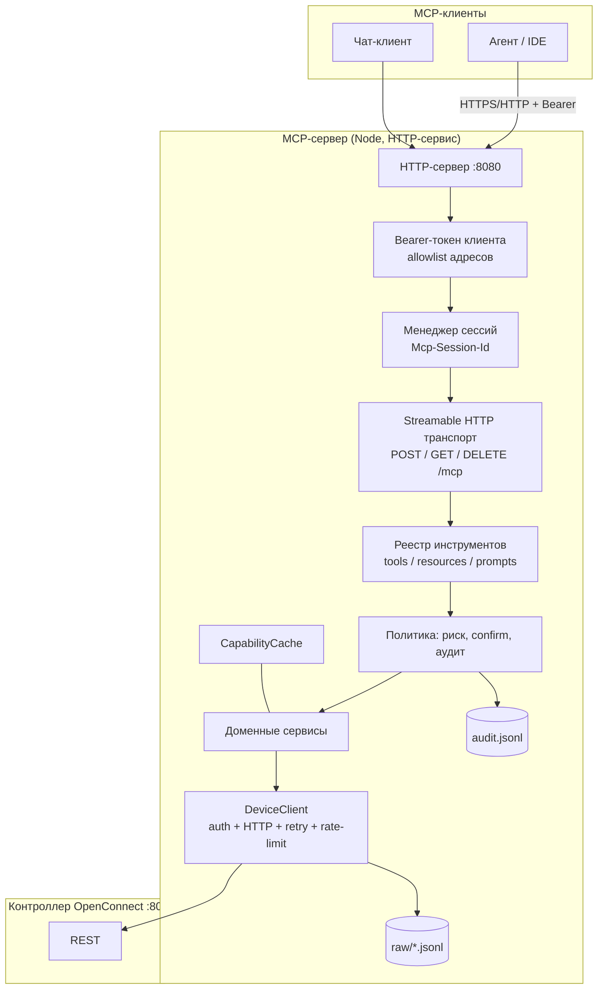

# MCP-сервер для OpenConnect: архитектура и план разработки

> **Статус:** RFC реализован в ветке `feature/mcp-server` (не запушена, в master не влита), редакция 3.
> Документ фиксирует результаты разбора фактического REST API прошивки (`APP_VERSION 0.2.9.2`), целевую
> архитектуру MCP-сервера и поэтапный план работ; отметки о выполнении — в §6, §9 и §12.
>
> **Решения этой редакции:** транспорт — **Streamable HTTP с первого этапа** (OpenConnect — сетевое
> устройство, проводное подключение к нему — редкий сценарий); описания инструментов — **на русском**;
> разрушительные операции **включены по явному флагу** и требуют подтверждения и причины (по умолчанию
> выключены); поддерживается **один контроллер**; пароли — **только в локальном `.env`**; запись сырых
> ответов — параметр `SSVC_RAW_LOG`, по умолчанию `off`.
>
> **Разбивка на пакеты работ для агентов:** [mcp-server-agents.md](mcp-server-agents.md) — волны,
> владение файлами, контракты, критерии приёмки и **статус выполнения** каждого пакета (§3.1).

---

## 0. С чего начать: состояние, точка остановки и очередь работ

> Это **входная точка** документации по MCP-серверу. Она отвечает на вопросы «что уже работает», «где
> остановились» и «что делать дальше». Подробности — в связанных документах (§0.4).

### 0.1 Статус на текущий момент

| Направление | Состояние | Чем подтверждено |
|---|---|---|
| Прошивка: доработки §9 | ✅ 8 пунктов (7 исходных + фикс скачивания файлов) | живое устройство `10.5.1.118` (fw 0.2.9.2): snapshot, события, `commandId`, JWT, OTA |
| MCP-сервер v1 | ✅ 50 инструментов, 5 промптов, 2 ресурса | 230 тестов, e2e через SDK-клиент, живая приёмка: 14 из 15 read-only вызовов `ok` |
| Docker и CI | ✅ образ собран, `HEALTHCHECK` → `healthy`, non-root | `ssvc-mcp:test` (271 MB), `docker compose config` → 0, `.github/workflows/mcp.yaml` |
| Документация | ✅ RFC, план пакетов, разведка контракта, события/безопасность/proxy | `mkdocs build --strict` без ошибок |
| Ветка | `feature/mcp-server`, **29 коммитов** поверх `origin/main` (на момент этой редакции) | не запушена, в master не влита |

### 0.2 Где именно остановились

**Точка остановки: v1 функционально готов и принят на стенде; следующая работа — очередь §0.3.**
Последние изменения: `6c28ad4` — починка `GET /rest/files/{path}` (маршрут перекрывался деревом);
`ace0701` — актуализация этого плана. Полная история пакетов и отклонений —
[mcp-server-agents.md §3.1–§3.2](mcp-server-agents.md).

Важно понимать границу проверенного: на живом устройстве подтверждены **чтения**, безопасные записи
(идемпотентные настройки, временные профили, копия/удаление временного файла) и OTA. Не проверялись
намеренно: калибровка XKC-25, `profile_apply`/`save_current`, переключение подсистем, `restart`,
`relay_override`, `update_hardware_config` — они необратимо меняют стенд.

### 0.3 Очередь работ (приоритет сверху вниз)

| ID | Задача | Зачем | Файлы | Критерий готовности |
|---|---|---|---|---|
| N1 | Уведомления об изменении ресурсов: `/ws/events` → `notifications/resources/updated` | клиент видит свежую телеметрию без опроса | `mcp/src/device/events.ts` (новый), `mcp/src/resources/telemetry.resource.ts`, `mcp/src/http/app.ts` | подписка MessagePack, reconnect, тест; живой сервер шлёт уведомление при смене стадии |
| N2 | Preflight перед `oc_start` | не отправлять команду, если датчик или железо заведомо блокируют старт | `mcp/src/domain/commands.ts`, `mcp/src/tools/commands.tools.ts` | `preflight` в ответе инструмента; тест; живой вызов при `block_start:false` |
| N3 | Ресурс-шаблон `logs/{id}.csv` | журнал доступен как ресурс, а не только файлом на сервере | `mcp/src/resources/logs.resource.ts` (новый), лимит размера в `src/config.ts` | `resources/templates/list` содержит шаблон; чтение отдаёт CSV в пределах лимита |
| N4 | 24-часовой soak | утечки, RSS и ошибки при долгой работе | `mcp/scripts/soak.mjs` (новый), отчёт в `docs/develop/` | 24 ч без падений, RSS стабилен, отчёт с числами |
| N5 | Матрица совместимости | secure/PCF8574/API 1.7 | фикстуры `mcp/test/`, сборки прошивки | таблица «конфигурация → результат» заполнена живыми прогонами |
| N6 | `docker compose up` и доступ к LAN из контейнера | сейчас проверен `docker run`; в этой среде LAN:80 из контейнера перехватывается | `mcp/docker-compose.yml`, `mcp/README.md` | compose поднимается; `/readyz` до устройства или документированный обход (host-network) |
| N7 | OTA/factoryReset как инструменты (опционально) | полный цикл обслуживания устройства | `mcp/src/tools/system.tools.ts` | риск 3, `confirm` + `reason`, тесты |

Вне очереди: мультиустройство, OAuth/DCR, MQTT-источник телеметрии — см. §6 P5.

### 0.4 Навигация по документам

| Документ | Что внутри | Когда читать |
|---|---|---|
| **этот файл** | архитектура, REST-контракт устройства, план P0–P4, чек-лист v1, состояние и очередь | первым |
| [mcp-server-agents.md](mcp-server-agents.md) | контракты §2, пакеты WP0–WP11, статусы §3.1, отклонения §3.2, очередь §3.3, старт агента §3.4, шаблоны §17–§18 | перед реализацией |
| [mcp-contract-notes.md](mcp-contract-notes.md) | разведка REST: каждый маршрут, коды, фикстуры, ловушки | при работе с эндпоинтом |
| [mcp-scenarios.md](mcp-scenarios.md) | пользовательские сценарии и ожидаемое поведение | при проектировании инструментов и промптов |
| [api/events.md](api/events.md), [api/security.md](api/security.md), [reverse-proxy.md](reverse-proxy.md) | протокол событий, JWT, TLS-прокси | при интеграции и эксплуатации |
| `mcp/README.md` (файл репозитория, вне docs-сайта) | запуск, `.env`, клиенты, ограничения | при запуске и отладке |

### 0.5 Как проверить текущее состояние

```powershell
cd mcp
npm ci
npm run typecheck; npm test; npm run build     # 230/230
node dist/index.js                              # /healthz, /readyz, /mcp
```

Живая проверка: `.env` с `SSVC_DEVICE_URL=http://10.5.1.118`, логином, паролем, `SSVC_MCP_TOKEN`
и портом; затем `curl -H "Authorization: Bearer <token>" http://127.0.0.1:<port>/readyz`.
Прошивка: `pio test -e native` (71 тест), сборка `pio run -e esp32-s3-devkitc-1-16m`.
Документация: `mkdocs build --strict`.

### 0.6 Правила для следующего агента (кратко)

1. Работать **только** в ветке `feature/mcp-server`; не пушить и не вливать в master без разрешения.
2. Читать в порядке: этот раздел → `mcp-server-agents.md` §1–§3 → своя секция пакета.
3. Не менять общие контракты §2 без запроса; чужие файлы — только чтение.
4. На стенде запрещены: калибровка XKC-25, `profile_apply`/`save_current`, переключение подсистем,
   `restart`, `relay_override`, `update_hardware_config` — они меняют стенд необратимо.
5. Готовность = `typecheck` 0, тесты зелёные, `build` ok, живая проверка (если безопасна), `git status`
   только со своими файлами.
6. Коммиты делает лид; отчёт о работе — по шаблону §18.

---

## 1. Цель и границы

### 1.1 Что делаем

Сетевой MCP-сервер (HTTP-сервис), который превращает REST-поверхность контроллера OpenConnect в
типизированные MCP-инструменты, ресурсы и промпты: «посмотреть состояние ректификации», «запустить
процесс по профилю», «прочитать журнал», «откалибровать датчик уровня», «диагностировать I²C».

Сервер работает там, где ему удобно (мини-ПК, NAS, Raspberry Pi, Docker на домашнем сервере), и
обращается к контроллеру по сети. MCP-клиенты (агенты, IDE, чат-клиенты) подключаются к серверу по HTTP
из той же сети или через тоннель.

MCP-сервер — **внешний адаптер**, а не второй бэкенд:

- прошивка остаётся единственным источником истины (состояние, гейты версий, предохранители);
- сервер не дублирует бизнес-логику ректификации и не хранит собственную модель процесса;
- сервер добавляет только то, чего у контроллера нет: типизацию, идемпотентные обёртки, ожидание
  терминальных состояний, политику опасных операций, аудит и удобный для LLM формат ответов.

### 1.2 Принятые решения и их следствия

| № | Решение | Что меняется в архитектуре |
|---|---|---|
| 1 | **Только HTTP-транспорт, сразу** | Постоянно работающий сервис: порт, сессии, аутентификация клиентов, TLS/прокси, health-check, Docker. stdio — не планируется (при необходимости добавляется обёрткой `mcp-remote` на стороне клиента) |
| 2 | **Описания инструментов на русском** | `title`, `description`, описания параметров, тексты ошибок и подсказки — русские. Ключи JSON, значения enum и имена инструментов остаются латиницей: это контракт |
| 3 | **Разрушительные операции включены до релиза**, с обязательным подтверждением | Флаг `SSVC_ALLOW_DESTRUCTIVE`, `confirm:true` + `reason`, аудит; отдельная задача «release hardening» выключает их перед релизом |
| 4 | **Один контроллер** | Нет реестра устройств, нет аргумента `device` в инструментах, нет mDNS-обнаружения. Конфигурация — один `.env`. В коде остаётся шов (`DeviceClient` как интерфейс), чтобы мультиустройство не потребовало переписывания |
| 5 | **Пароли только в локальном `.env`** | `dotenv`, `.env` в `.gitignore`, `.env.example` в репозитории; никаких keyring, облачных хранилищ и паролей в аргументах/логах |
| 6 | **Сырые ответы пишем на время разработки** | `SSVC_RAW_LOG=all` в P0–P3, `off` по умолчанию в P4; точечно — параметр `debug:true` в вызове инструмента |

### 1.3 Не-цели

| Не делаем | Почему |
|---|---|
| Прошивку на ESP32, говорящую на MCP | +память, +TLS, +JSON-RPC на устройстве без выгоды: клиенты и так ходят по сети |
| stdio-транспорт в v1 | Сервер живёт как сервис; stdio-клиенты подключаются через `mcp-remote` |
| Мультиустройство | Один контроллер; реестр появится, если понадобится, без изменения доменного слоя |
| Собственную очередь команд поверх устройства | Очередь уже есть в прошивке (`SsvcCommandsQueue`, 50 слотов + safety-очередь) |
| OAuth/DCR в v1 | Один пользователь, статический bearer-токен; OAuth — только если клиент не умеет заголовки |
| Замену веб-интерфейсу | UI остаётся; MCP — ещё один клиент того же API |
| Автоматическое «ведение» ректификации без человека | Опасный процесс: сервер даёт инструменты, решение принимает человек/агент с подтверждением |

### 1.4 Пользовательские сценарии

Полный каталог — **29 сценариев** в девяти группах, с разбором ситуаций, эффекта и ограничений:
[mcp-scenarios.md](mcp-scenarios.md).

Коротко, что покрывается:

| Группа | Примеры |
|---|---|
| Перед запуском | готовность оборудования, «почему не стартует», что умеет прошивка |
| Ведение процесса | запуск с отсрочкой, ручные переходы, закрытие клапана, аварийная остановка |
| Ночной дозор | события и эскалация, обнаружение застоя |
| Настройка параметров | гистерезис и предекремент, формула, сброс и снижение, `valve_bw`, правка на ходу |
| Профили и расчёт | профиль из расчёта, расхождение с контроллером, перенос на другой аппарат |
| Разбор после процесса | разбор журнала, план против факта, статистика по сырью |
| Безопасность | датчики уровня, пороги тревог, реле-автоматика |
| Диагностика | шина I²C, «настройки не применились», журнал не качается |
| Интеграции | мессенджеры, умный дом, строка `STATUS` на экране |

Сценарии опираются на фактическое поведение прошивок 2.2.55 (Pro) и 2.3.28 (Pro.3H), UART API
SSVC0059_V2 и калькулятор ректификации OpenConnect; расхождения источников зафиксированы в
[mcp-scenarios.md §15](mcp-scenarios.md).

---

## 2. Что есть на контроллере: разбор REST API

### 2.1 Транспорт и адресация

| Параметр | Факт | Следствие для MCP |
|---|---|---|
| HTTP | `AsyncWebServer`, **порт 80, только HTTP** | TLS на стороне устройства нет; MCP-сервер работает по HTTP внутри доверенной сети, наружу — только через TLS-прокси |
| mDNS | `MDNS.begin(<hostname>)`, сервисы `http`/`ws`, TXT `Firmware Version` | Адрес контроллера задаётся в `.env`; mDNS-поиск не нужен |
| CORS | `ENABLE_CORS` **закомментирован** в `platformio.ini` | Браузерный клиент напрямую к устройству не сходится; для MCP не важно |
| Сборки | `-secure` = `FT_SECURITY=1`, обычная = `FT_SECURITY=0` | На обычной сборке аутентификации нет: `verifyAuthorization` → 404 |
| Статика | `EMBED_WWW` или LittleFS | На API не влияет |

### 2.2 Аутентификация и авторизация

```
POST /rest/signIn   {"username":"admin","password":"admin"}  →  200 {"access_token":"<JWT>"}
GET  /rest/verifyAuthorization                                →  200 | 401 (404 — security выключена)
```

- JWT передаётся либо заголовком `Authorization: Bearer <jwt>`, либо query-параметром
  `?access_token=<jwt>` (второй вариант нужен WebSocket).
- Payload JWT: `{"username": "...", "admin": true|false}`. **Поля `exp` нет** — токен не истекает,
  пока не сменится `jwtSecret`; перевыпуск — по `GET /rest/generateToken` (только admin).
- Два уровня доступа: `IS_AUTHENTICATED` (любой пользователь) и `IS_ADMIN`.

> **Критично.** `HttpEndpoint<T>` по умолчанию применяет `IS_ADMIN`, и прикладные сервисы
> (`/rest/telemetry`, `/rest/sensor`, `/rest/alarms`, `/rest/zones`, а также WiFi/NTP/MQTT/AP/System)
> предикат не переопределяют. То есть **телеметрия и датчики доступны только администратору**, а
> `/rest/settings`, `/rest/commands`, `/rest/oc/*`, `/rest/profiles*`, `/rest/files*`, `/rest/logs` —
> любому аутентифицированному. MCP-серверу нужна учётная запись admin, иначе половина инструментов
> вернёт `403`, что легко принять за «устройство не поддерживает».

### 2.3 Каналы данных

| Канал | Что даёт | Пригодность для MCP |
|---|---|---|
| **REST** | всё: телеметрия, настройки, команды, журналы, файлы | основной канал |
| **WebSocket** `/ws/events` | push-события `battery`, `wifi/rssi`, `features`, `notification`, `ota`, а начиная с прошивки с §9 — ещё `telemetry`, `stage`, `alarm`. Формат кадров **MessagePack** (`EVENT_USE_JSON` выключен); управляющий кадр подписки `{event:"subscribe",data:"<name>"}` — **тоже MessagePack**, текстовый JSON сервер игнорирует | пригоден для «ждать изменения» без опроса: `telemetry` — полный снимок при изменении (не чаще ~1 раза в 2 с) плюс догоняющая отправка при подписке; `stage` — только переход стадии/статуса/pid; `alarm` — только raise/clear, догоняющей отправки нет (снимок — REST). Описание: `docs/develop/api/events.md` |
| **MQTT** | `openconnect/telemetry`, `openconnect/settings`, `openconnect/sensor/state`, `openconnect/sensor/threshold/*`, команды `openconnect/command/send` + `.../response` | альтернатива для «сервер всегда онлайн», но требует брокера и не покрывает журналы/профили → во второй очереди |

**Вывод:** базовое состояние читаем из REST (`GET /rest/oc/snapshot` — один запрос вместо четырёх),
а ожидание изменений строим на `/ws/events` (`telemetry`/`stage`/`alarm`) с откатом на опрос,
если сокет недоступен.

### 2.4 Инвентарь эндпоинтов

Обозначения: **R** — чтение, **W** — обратимая запись, **P** — влияет на процесс, **D** — разрушительно.

#### 2.4.1 Аутентификация и служебное

| Метод | Путь | Доступ | Назначение |
|---|---|---|---|
| POST | `/rest/signIn` | — | логин, выдаёт JWT (`{access_token}`); payload содержит `username`, `admin` и, при синхронизированных часах, `iat`/`exp` |
| GET | `/rest/refreshToken` | auth | новый токен для текущего пользователя: `{token, exp}`; **только на secure-сборке** — на не-secure маршрута нет и GET отдаёт SPA-заглушку (`200 text/html`) |
| GET | `/rest/verifyAuthorization` | любой | проверка токена (404 — security off; 401 — токен истёк/невалиден) |
| GET | `/rest/features` | auth | рантайм-флаги фич |
| GET | `/rest/systemStatus` | admin | heap, uptime, прошивка, чип |
| GET/POST | `/rest/restart` | admin | перезагрузка (POST) |
| POST | `/rest/factoryReset` | admin | сброс к заводским |
| GET | `/rest/coreDump` | admin | дамп паники |
| GET/POST | `/rest/wifiStatus`, `/rest/wifiSettings`, `/rest/apStatus`, `/rest/apSettings`, `/rest/ntpStatus`, `/rest/ntpSettings`, `/rest/mqttStatus`, `/rest/mqttSettings`, `/rest/securitySettings` | admin | состояния и настройки подсистем фреймворка |
| GET/POST | `/rest/scanNetworks`, `/rest/listNetworks`, `/rest/time` | admin | сканирование Wi-Fi, установка времени |
| POST | `/rest/uploadFirmware`, `/rest/downloadUpdate` | admin | OTA (`FT_UPLOAD_FIRMWARE`/`FT_DOWNLOAD_FIRMWARE`) |
| — | `/rest/sleep` | — | **не существует** в этой сборке (`FT_SLEEP=0`) |

#### 2.4.2 Ректификация (ядро)

| Метод | Путь | Доступ | Тип | Примечание |
|---|---|---|---|---|
| GET | `/rest/telemetry` | **admin** | R | `{telemetry:{...}, status:{stage,status,startTime,endTime,stages,uartConnectionError}, lastUpdate}`; кэш 2 с |
| GET | `/rest/settings` | auth | R | `{ssvcSettings:{...}}` — **вложенный** объект |
| PUT | `/rest/settings` | auth | W | тело — **плоский** объект `{"hyst":0.5}`; ответ `{success,accepted,ignored[],skipped[]}` |
| POST | `/rest/commands` | auth | P/D | `{commands:"start",parameters:""}`; **200 = принято в очередь, не выполнено**; ответ `{status:"accepted",command,commandId,warnings?[]}` (warnings — предупреждения предохранителей, команда всё равно принята) |
| GET | `/rest/commands/{id}` | auth | R | журнал попытки (TTL 10 мин, кольцо на 16 записей): `{id,command,state,queued_at,started_at,finished_at,ok,reason,confidence:"transport"}`; `state` ∈ `queued/running/sent/done/rejected/timeout`; 400 `invalid_id`, 404 `not_found` (в т.ч. вытесненная запись). `confidence:"transport"` — подтверждение только на уровне транспорта UART, не «физическое действие выполнено» |
| GET | `/rest/subsystem` | auth | R | карта `{i2c_bus, thermal, atm_sensor, telegram_bot, vk_bot, settings}` |
| PUT | `/rest/subsystem` | auth | W | `{name:bool}`; ответ `{success, errors[]}`; отдельные подсистемы включаются >60 с |
| GET | `/rest/sensor` | **admin** | R | `{<zone>:{<address>:{v,u,type}}}` |
| GET/POST | `/rest/zones` | **admin** | R/W | привязка датчиков к зонам |
| GET/POST | `/rest/alarms` | **admin** | R/W | `{thresholds:{<addr>:{enabled,min,dangerous,critical}}}` |
| PUT | `/rest/sensors/zone` | auth | W | `?address=&zone=` (одна привязка) |

Команды `COMMAND_MAP`: `at`, `next`, `pause`, `stop`, `start`, `resume`, `version`, `get_settings`,
`settings`, `emergency_stop`, `status`, `set`, `get_log`.

#### 2.4.3 OpenConnect (`/rest/oc/*`)

| Метод | Путь | Тип | Ответ |
|---|---|---|---|
| GET | `/rest/oc/info` | R | `{ssvc:{version,api,api_code,mode}, oc:{version,is_support_api,is_support_release,api_min,api_target,api_compatibility,api_features[{name,min_api,available}]}}` |
| GET | `/rest/oc/snapshot` | R (admin) | **агрегат для MCP:** одна сводка `{observed_at, info, telemetry, status, lastUpdate, sensor, faults, partial[]}`; `partial` — имена компонентов, которые не удалось собрать (например `["sensor"]` при сбое шины). Admin, потому что `/rest/telemetry` и `/rest/sensor` — admin |
| GET | `/rest/oc/hardware-config` | R | конфиг I²C-устройств + пробы `bmp581ProbeOk`/`ds3231ProbeOk`/`lcd1602ProbeOk`/`relayPcf8574ProbeOk[]`, `needsReboot`, `capabilities` |
| PUT | `/rest/oc/hardware-config` | W | частичное обновление, валидация, `needsReboot` |
| GET | `/rest/oc/hardware-faults` | R | `{faults[{code,codeLabel,address,role}],count,i2cBusActive,i2cScan[]}` |
| GET | `/rest/oc/xkc25/status` | R | датчики уровня: `live`,`rawLevel`,`filled`,`calibrated`, `blockStart`,`blockReasons[]`,`warnings[]` |
| POST | `/rest/oc/xkc25/calibrate` | W | `{index, step}` где `step` = `without_liquid` / `with_liquid` / `verify_return`; `verify_return` → **202**, затем `GET .../verify-status` |
| GET | `/rest/oc/xkc25/verify-status` | R | `{status}` ∈ `none` / `pending` / `done`, плюс `ok`, `completed`, `code`, `rawLevel`, `message` |
| GET | `/rest/oc/relay/capabilities` | R | `{supported, pcf8574:{...}}`; на GPIO-сборке `supported:false` |
| GET | `/rest/oc/relay/metadata` | R | реле, их `targetBit`, `editable`, причины блокировки, коды сбоев, стадии, поля SSVC |
| GET | `/rest/oc/relay/state` | R | `{supported, userShadow, userShadows[]}` |
| POST | `/rest/oc/relay/override` | P | `{bit, enable?, energized?}`; **`enable` по умолчанию `true`**, если не передан |

#### 2.4.4 Профили, журналы, файлы

| Метод | Путь | Тип | Примечание |
|---|---|---|---|
| GET | `/rest/profiles` | R | список метаданных |
| GET | `/rest/profiles/active` | R | `{id}` или 404 |
| GET | `/rest/profiles/content?id=` | R | полный профиль (включая `ssvcSettings`, `analytics`, правила реле) |
| POST | `/rest/profiles` | W | создать `{name,content?}` → 201 `{success,id}` |
| POST | `/rest/profiles/copy` | W | `{sourceId,newName}` |
| POST | `/rest/profiles/content` | W | `{id,content}` |
| POST | `/rest/profiles/save` | W | сохранить текущие настройки в профиль |
| POST | `/rest/profiles/set-active` | P | сделать активным и **применить** к контроллеру |
| PUT | `/rest/profiles/meta` | W | переименовать `{id,name}` |
| DELETE | `/rest/profiles/delete` | D | `{id}` (тело в DELETE!) |
| GET | `/rest/logs` | R | stateful-сессия: `?statusOnly=1`, `?refresh=1`; статусы `idle/list/receiving/completed/error` |
| GET | `/rest/logs/{processId}` | R | 202 + прогресс, затем **CSV** (`Content-Disposition`) |
| DELETE | `/rest/logs` | W | отмена передачи |
| GET | `/rest/files` | R | дерево LittleFS |
| GET | `/rest/files{path}` | R | скачать файл |
| POST | `/rest/files/copy` | W | `{source,destination}` |
| DELETE | `/rest/files{path}` | D | удалить файл |

#### 2.4.5 Мессенджеры

| Метод | Путь | Примечание |
|---|---|---|
| GET/PUT | `/rest/telegram/config` | `{token,chat_id}` |
| GET/PUT | `/rest/vk/config`, POST `/rest/vk/peers` | `FT_VK_BOT` |

### 2.5 Особенности контракта, которые определяют архитектуру

Это главный результат разбора: MCP-сервер нельзя писать как «тонкий проброс URL».

| № | Поведение | Что должен делать MCP-сервер |
|---|---|---|
| 1 | `POST /rest/commands` асинхронен: 200 = «в очереди», не «выполнено» | инструмент возвращает `accepted` + отдельный инструмент/режим ожидания (`oc_wait_for_change`) |
| 2 | `start` может вернуть **409** `{status:"rejected",blockReasons[]}` — предохранитель XKC-25 | разобрать `blockReasons` в структурированную ошибку с подсказкой, что калибровать |
| 3 | Отказ очереди: **409** `feature_unsupported` (старая прошивка), **503** `queue_full` | разные коды ошибок MCP; `queue_full` — ретрай с backoff, `feature_unsupported` — нет |
| 4 | `PUT /rest/settings` при частичном сбое: **503** + `partial:true`, часть SET уже ушла | **никогда не повторять тело целиком**; вернуть «частично применено» и перечитать `GET /rest/settings` |
| 5 | GET отдаёт `{ssvcSettings:{...}}`, PUT ждёт плоский объект; неизвестные ключи молча уходят в `ignored` | адаптер оборачивает/разворачивает; `ignored` доносится до пользователя явно |
| 6 | `/rest/logs` — одна сессия передачи на устройство: `409 log_transfer_busy`, 202 + поллинг | на устройство — мьютекс/лиз; скачивание в файл, а не в контекст модели |
| 7 | `verify_return` в калибровке асинхронен (202) | двухшаговый инструмент: постановка → опрос `verify-status` |
| 8 | `relay/override`: `enable` по умолчанию `true` | всегда передавать `enable` и `energized` явно |
| 9 | GPIO-сборка отдаёт `{"supported":false}` вместо ошибки | трактовать как «функция недоступна в этой прошивке», а не как сбой |
| 10 | Ответы команд — `text/plain`, остальное — JSON | толерантный парсер + нормализация в `structuredContent` |
| 11 | В UI есть вызовы `/rest/sensors/thresholds` и `/rest/profiles/import`, которых **нет в прошивке** | не моделировать; пороги — через `/rest/alarms`, импорт — через `POST /rest/profiles` |
| 12 | Включение `telegram_bot` может занять >60 с | таймауты инструментов подсистем ≥120 с, не блокировать общий пул |
| 13 | `POST /rest/commands` возвращает `commandId`, но журнал живёт 10 мин и кольцом на 16 записей; `confidence:"transport"` означает «ушло в UART», а не «сделано» | опрашивать `GET /rest/commands/{id}` до терминального `state`, но трактовать `done` как «устройство подтвердило транспорт», а `sent` (START/NEXT/RESUME/STOP) — как «принято, ответа не будет»; 404 означает «запись вытеснена», а не «команда не выполнялась» |
| 14 | Регистрация маршрутов чувствительна к порядку/матчеру (см. комментарии в `HandlerRegistrator.cpp`) | никогда не добавлять завершающий `/` и не «нормализовать» пути |
| 15 | `HttpEndpoint` по умолчанию `IS_ADMIN` | учётка admin либо явная проверка `GET /rest/telemetry` на старте |
| 16 | Неизвестный GET (и любой GET несуществующего `/rest/*`) отдаёт **SPA-заглушку**: `200 text/html`, ~664 Б `<!DOCTYPE html>` | проверять `Content-Type`/тело, а не только код: иначе «route отсутствует» выглядит как успех. Касается, например, `/rest/refreshToken` на не-secure сборке |
| 17 | `lastUpdate` в `/rest/telemetry` и `/rest/oc/snapshot` — это `millis()` (uptime устройства), не epoch; `observed_at` в snapshot — тоже uptime | свежесть считать по монотонному времени устройства или по времени получения ответа, не сравнивать с `Date.now()` |
| 18 | События `/ws/events` — только при подключённом клиенте и только по подписке; подписка — MessagePack-кадр | при старте подписываться на `telemetry`/`stage`/`alarm`, при обрыве — переподключаться с backoff; пропущенное не догоняется (кроме снимка при подписке), поэтому после реконнекта перечитать `/rest/oc/snapshot` |
| 19 | `alarm`-событие не имеет истории и догоняющей отправки | текущие тревоги читать из `GET /rest/oc/hardware-faults` и порогов; событие использовать как триггер «перечитать», а не как источник истины |
| 20 | `ESPAsyncWebServer` **не принимает `Transfer-Encoding: chunked`**: POST/PUT с телом без `Content-Length` приводят к обрыву соединения (`ECONNRESET`) до разбора тела | всегда отправлять тело с явной длиной; в MCP-сервере это делает общий транспорт (`src/device/http.ts`), а не отдельные домены |
| 21 | `GET /rest/files{path}` был перекрыт обработчиком дерева: `server.on("/rest/files", …)` в этом форке — `BackwardCompatible`-матчер, совпадающий и с `/rest/files/<path>`, поэтому запрос файла возвращал `200 application/json` с деревом | **исправлено в ветке** (§9, п. 8): дерево регистрируется через `AsyncURIMatcher::exact`. Для старых прошивок MCP-сервер распознаёт ответ-дерево по телу и сообщает `feature_unsupported` с подсказкой обновить прошивку, а не сохраняет дерево как файл |

### 2.6 Версии и возможности

`GET /rest/oc/info` отдаёт реестр возможностей с минимальной версией API: `base`(1.7), `formula`(1.7),
`extended_heads`(1.8), `tank_mmhg_act`(1.7), `predec`(1.9), `formula_auto92`(1.9),
`hearts_preempt_cnt`(1.8), `get_log`(1.10). Сравнение — целым кодом `major*100+minor`, не строкой.
Тот же принцип обязателен в MCP-сервере: **инструмент не «исчезает» молча, а отвечает
`feature_unsupported` с `required_api`/`device_api`**, повторяя формулировки прошивки.

---

## 3. Целевая архитектура

### 3.1 Принципы

1. **Сервис, а не процесс на одну сессию.** HTTP-сервер запускается один раз (Docker/systemd) и живёт
   постоянно; клиенты подключаются и отключаются, состояние устройства от этого не зависит.
2. **Capability-first.** На старте сессии — `GET /rest/oc/info` + `/rest/features`; реестр инструментов
   и их описания учитывают возможности устройства.
3. **Никакой «магии» поверх процесса.** Сервер не решает, когда переходить фракцию; он даёт
   детерминированные операции и наблюдение.
4. **Один ответ — одно состояние.** Каждый инструмент возвращает снимок + `observed_at`, а не поток.
5. **Single-flight и один писатель на устройство.** Параллельные чтения схлопываются, записи
   сериализуются: ESP32 не должна получать конкурирующие команды от двух агентов.
6. **Опасное — явно.** Классы риска, подтверждение, аудит, флаг `SSVC_ALLOW_DESTRUCTIVE`.
7. **Ошибка — данные.** Структурированный `code` + `hint` + `retryable`, а не текст исключения.
8. **Контракт = zod-схемы рядом с типами фронтенда.** `interface/src/lib/types/ssvc.ts` — источник
   для схем; расхождение ловится контрактными тестами.

### 3.2 Слои



### 3.3 Структура репозитория

Каталог `mcp/` — самостоятельный npm-пакет внутри репозитория (не часть прошивки и не часть
`interface/`, чтобы не ломать сборку фронта и `pio`).

```
mcp/
├── package.json                 # "type":"module", bin: ssvc-openconnect-mcp
├── tsconfig.json
├── Dockerfile
├── docker-compose.yml           # сервис + (опционально) Caddy для TLS
├── .env.example                 # без секретов, с комментариями
├── README.md                    # запуск, .env, подключение клиентов
├── src/
│   ├── index.ts                 # сборка: конфиг → сервис → serve
│   ├── config.ts                # zod-схема .env, отказ старта без обязательных
│   ├── logging.ts               # структурный лог (JSON) в stdout
│   ├── http/
│   │   ├── app.ts               # node:http, маршруты /mcp /healthz /readyz
│   │   ├── auth.ts              # сверка Bearer-токена, CIDR-allowlist
│   │   ├── sessions.ts          # Map<sessionId, Session>, лимиты, idle-cleanup
│   │   └── tls.ts               # встроенный TLS (cert/key) или «за прокси»
│   ├── rawlog.ts                # запись сырых обменов + редакция секретов
│   ├── audit.ts                 # JSONL-аудит опасных операций
│   ├── mcp/
│   │   ├── server.ts            # создание McpServer на сессию
│   │   ├── errors.ts            # код → MCP-ошибка, маппинг HTTP
│   │   ├── resources.ts         # openconnect://..., подписки
│   │   └── prompts.ts           # сценарии (рус.)
│   ├── device/
│   │   ├── DeviceClient.ts      # HTTP, таймауты, ретраи, single-flight
│   │   ├── AuthSession.ts       # signIn, кэш JWT, relogin на 401
│   │   ├── CapabilityCache.ts   # /rest/oc/info, TTL, инвалидация
│   │   ├── WriteQueue.ts        # один писатель, приоритет чтений
│   │   └── schemas/             # zod: telemetry, settings, oc, profiles, logs
│   ├── domain/                  # Info, Telemetry, Command, Settings, Sensor,
│   │                            # Relay, Xkc25, Logs, Profile, System
│   ├── tools/                   # по файлу на домен, декларативная регистрация
│   └── policy/
│       ├── risk.ts              # классы риска и аннотации
│       └── confirmation.ts      # проверка confirm/reason, флаг destructive
├── mock/                        # заглушка устройства + фикстуры 1.7 / 1.10
└── test/                        # unit / contract / http / e2e
```

### 3.4 Транспорт, сессии и доступ

**Стек.** `@modelcontextprotocol/sdk@1.32.2` (зафиксирован), `node:http` без веб-фреймворка, zod 3,
Node ≥ 22. Отказ от Fastify/Express осознанный: маршрутов три, а любая прослойка добавляет зависимость
и второй слой обработки тела запроса.

**Эндпоинт.** Один путь `/mcp` (по умолчанию), обслуживающий `POST`, `GET` и `DELETE` в соответствии со
Streamable HTTP. `GET` открывает SSE-поток сервер→клиент (нужен для `notifications/resources/updated`),
`DELETE` завершает сессию. `POST` несёт JSON-RPC.

**Сессии.** Состояние нужно: подписки на ресурсы и уведомления привязаны к сессии. Поэтому режим
stateful:

| Параметр | Значение | Обоснование |
|---|---|---|
| `sessionIdGenerator` | `randomUUID()` | криптостойкий идентификатор |
| `MAX_SESSIONS` | 32 | один пользователь, несколько агентов; защита от утечки памяти |
| `IDLE_MS` | 30 мин | сессия без открытых ответов закрывается |
| `onsessioninitialized` / `onsessionclosed` | учёт в `Map`, лог, счётчики | наблюдаемость |
| Неизвестный `Mcp-Session-Id` | `404` | клиент пересоздаёт сессию |
| Нет `Mcp-Session-Id` на не-init запросе | `400` | нарушение протокола |
| `isInitializeRequest` + лимит сессий | `503` | «слишком много сессий» |

**Доступ к серверу.**

| Механизм | Реализация |
|---|---|
| Аутентификация клиента | `Authorization: Bearer ${SSVC_MCP_TOKEN}`; сравнение в постоянном времени; `401` + `WWW-Authenticate: Bearer` |
| Обязательность токена | сервер **не стартует** без `SSVC_MCP_TOKEN` (fail-fast, а не «открытый порт») |
| Сетевой фильтр | `SSVC_MCP_ALLOWED_CIDRS` (по умолчанию — вся частная сеть) |
| DNS-rebinding | `SSVC_MCP_ALLOWED_HOSTS` + проверка `Host`/`Origin`; запросы без `Origin` разрешены (не браузерные клиенты) |
| TLS | встроенный (`SSVC_MCP_TLS_CERT`/`_KEY`) либо Caddy/Traefik перед сервисом; наружу — только TLS |
| CORS | выключен: браузерных MCP-клиентов не поддерживаем |
| Проверка живости | `GET /healthz` (без токена, только «процесс жив»), `GET /readyz` (с токеном: проверка `GET /rest/oc/info`) |

**Ограничения конкурентности.** Несколько агентов одновременно — реальность HTTP-режима, поэтому:

- не более 4 одновременных вызовов на сессию;
- глобальная очередь к устройству глубиной 16, дальше — `503 busy`;
- чтения имеют приоритет над записями; записи — строго по одной (`WriteQueue`);
- бюджет запросов к ESP32 — общий на процесс, а не на сессию.

### 3.5 DeviceClient — ядро надёжности

Ответственность: превратить «сырой HTTP к ESP32» в предсказуемый вызов.

| Возможность | Реализация |
|---|---|
| Аутентификация | `AuthSession`: ленивый `signIn`, кэш JWT в памяти, `401` → один повтор после `signIn`; `404` на `verifyAuthorization` = security off, токен не нужен |
| Таймауты | connect 2 с, read 10 с по умолчанию; per-tool override; `GET /rest/logs/{id}` — до 60 с |
| Ретраи | только `GET` и только на сетевые ошибки/`502-504`/`503 queue_full`, экспоненциальный backoff 3 попытки; **POST/PUT/DELETE не ретраятся** |
| Rate limit | token bucket: 5 rps burst 10, потолок по умолчанию 2 rps для опроса |
| Single-flight | `Map<key, Promise>`: одновременные `getTelemetry()` → один запрос |
| Запись | `WriteQueue` с мьютексом на устройство; дедуп одинаковых вызовов в пределах 1 с |
| Нормализация | `text/plain` → `{raw}`; `{"supported":false}` → `featureUnavailable`; `409/503` → коды |
| Наблюдаемость | длительность, статус, размер ответа; счётчики для `oc_diagnostics` |

Скелет:

```ts
export class DeviceClient {
  constructor(
    private readonly cfg: DeviceConfig,
    private readonly auth: AuthSession,
    private readonly raw: RawLogger,
  ) {}

  async getJson<T>(path: string, schema: z.ZodType<T>, opts: ReadOpts = {}): Promise<T> {
    return this.singleFlight(`GET ${path}`, async () => {
      const { status, body, ms } = await this.request('GET', path, undefined, opts);
      await this.raw.record({ method: 'GET', path, status, ms, response: body });
      return schema.parse(body);
    });
  }

  async postCommand(name: CommandName, params = ''): Promise<CommandAccepted> {
    // 200 → accepted; 409/503 → типизированный отказ, без ретрая
    return this.write(() =>
      this.deserialize(
        this.request('POST', '/rest/commands', { commands: name, parameters: params }),
        commandAcceptedSchema,
        { method: 'POST', command: name },
      ),
    );
  }
}
```

### 3.6 Доменные сервисы

Каждый сервис — единственное место знания о своём участке REST и о его странностях.

| Сервис | REST | Что инкапсулирует |
|---|---|---|
| `InfoService` | `/rest/oc/info`, `/rest/features`, `/rest/systemStatus` | capability-модель, совместимость версий |
| `TelemetryService` | `/rest/telemetry`, `/rest/sensor` | снимок, `lastUpdate`, «изменилось ли», ожидание стадии |
| `CommandService` | `/rest/commands` | имена команд, разбор 409/503, `emergency_stop`, ожидание эффекта |
| `SettingsService` | `/rest/settings` (GET/PUT) | обёртка/разворот `ssvcSettings`, отчёт `accepted/ignored/skipped`, запрет слепого ретрая |
| `SensorService` | `/rest/zones`, `/rest/sensors/zone`, `/rest/alarms`, `/rest/sensor` | зоны и пороги; admin-only |
| `RelayService` | `/rest/oc/relay/*` | `supported:false`, обязательные `enable`/`energized`, зарезервированные биты |
| `Xkc25Service` | `/rest/oc/xkc25/*` | двухшаговая калибровка, `blockReasons`, `verify-status` |
| `LogsService` | `/rest/logs*` | лиз сессии, 202-поллинг, CSV в файл, `409 busy` |
| `ProfileService` | `/rest/profiles*` | CRUD + «применить активный», порядок путей |
| `SystemService` | `/rest/subsystem`, `/rest/hardware-*`, `/rest/systemStatus` | длинные таймауты, `needsReboot` |

### 3.7 MCP-слой: инструменты, ресурсы, промпты

**Инструменты.** Имя `oc_<область>_<действие>`, snake_case, латиницей (это часть контракта); всё
остальное — по-русски:

- `title` и `description` — русские, 1–2 предложения: что делает и **чего не делает** (например,
  «ставит в очередь, не ждёт выполнения»);
- описания параметров — русские (`confirm`: «явное подтверждение влияющего на процесс действия»);
- `inputSchema` — строгий zod, `additionalProperties:false`;
- `annotations`: `readOnlyHint`, `destructiveHint`, `idempotentHint`, `openWorldHint:false`;
- `outputSchema` + `structuredContent` — чтобы клиент видел поля, а не текст;
- тексты ошибок и `hint` — русские; `code`, `details.*` — латиницей.

**Ресурсы** (URI без сегмента устройства — контроллер один; подписка → уведомление при изменении):

| URI | Содержимое |
|---|---|
| `openconnect://info` | версии, возможности, совместимость |
| `openconnect://telemetry` | последний снимок |
| `openconnect://settings` | действующие настройки SSVC |
| `openconnect://alarms` | пороги и активные сбои |
| `openconnect://profiles` | список профилей |
| `openconnect://logs/{processId}.csv` | скачанный журнал |

**Промпты** (готовые сценарии на русском, снижают число ошибок модели):

1. `start_rectification` — проверить info/telemetry/guard → предложить старт → подтвердить → ждать стадию.
2. `troubleshoot_start_blocked` — разобрать `blockReasons`, `hardware-faults`, `i2cScan`.
3. `calibrate_xkc25` — мастер из трёх шагов с проверкой состояния между ними.
4. `analyze_last_run` — журнал + телеметрия → краткий разбор.
5. `apply_profile` — выбрать профиль, показать diff настроек, применить.

### 3.8 Состояние, кэш и «ожидание»

- **Снимок телеметрии** кэшируется 1–2 с (сервер всё равно обновляет его раз в 2 с); `lastUpdate`
  отдаётся клиенту, чтобы он видел актуальность. Частота фонового опроса — `SSVC_POLL_HZ` (по умолчанию 1 Гц),
  с джиттером; при отсутствии подписчиков опрос не выполняется.
- **Capability-кэш** — TTL 60 с + инвалидация по `404`/`409 feature_unsupported`/`restart`.
- **Ожидание** реализуется отдельными инструментами, а не долгим `await` внутри команды:
  `oc_wait_for_change({expect:{stage:"hearts"}, timeout_s:120})` — поллинг с адаптивным интервалом
  (0.5 с → 2 с), возврат `{matched, observed, elapsed_s}` или `{timeout:true, observed}`.
  Это важно: MCP-клиенты любят таймауты, а процесс идёт минутами.
- **Дедупликация записи**: одинаковый вызов в пределах 1 с возвращает результат первого (защита от
  «двойного клика» агента и от двух агентов, делающих одно и то же).
- **Разрыв сессии** не отменяет команду на устройстве; `oc_diagnostics` показывает активные сессии.

### 3.9 Один контроллер: конфигурация и секреты

Конфигурация — только `.env` рядом с сервисом (или переменные окружения контейнера). Файл создаётся
пользователем из `.env.example`, в git не попадает.

| Переменная | Обязательна | По умолчанию | Назначение |
|---|---|---|---|
| `SSVC_DEVICE_URL` | да | — | `http://192.168.1.42` |
| `SSVC_USER` | да | `admin` | учётка контроллера (**admin**) |
| `SSVC_PASSWORD` | да | — | пароль контроллера |
| `SSVC_MCP_TOKEN` | да | — | bearer-токен для MCP-клиентов; без него старт запрещён |
| `SSVC_MCP_BIND` | нет | `0.0.0.0` | адрес прослушивания |
| `SSVC_MCP_PORT` | нет | `8080` | порт |
| `SSVC_MCP_ALLOWED_HOSTS` | при `bind 0.0.0.0` | — | список `Host` для защиты от DNS-rebinding |
| `SSVC_MCP_ALLOWED_CIDRS` | нет | `private` | кто может подключаться |
| `SSVC_MCP_TLS_CERT` / `_KEY` | нет | — | встроенный TLS; иначе — за прокси |
| `SSVC_ALLOW_DESTRUCTIVE` | нет | `1` до релиза | разрушительные инструменты |
| `SSVC_RAW_LOG` | нет | `all` до релиза | `off` / `errors` / `all` |
| `SSVC_RAW_LOG_MAX_MB` | нет | `50` | предел каталога сырых логов |
| `SSVC_ALLOW_DEBUG` | нет | `1` до релиза | разрешить `debug:true` в вызовах |
| `SSVC_POLL_HZ` | нет | `1` | частота фонового опроса |
| `SSVC_AUDIT_PATH` | нет | `./logs/audit.jsonl` | аудит |
| `SSVC_LOG_LEVEL` | нет | `info` | уровень логов |

Правила секретов:

- `.env` в `.gitignore`; в репозитории только `.env.example` с пустыми значениями;
- права файла `600`, владелец — пользователь сервиса; в Docker — `env_file`, не `environment`;
- пароли и токены **никогда** не попадают в логи, аудит, сырые логи и `oc_diagnostics`;
- смена пароля контроллера — только правка `.env` + рестарт сервиса (relogin автоматический);
- генерация `SSVC_MCP_TOKEN`: `openssl rand -hex 32`.

### 3.10 Ошибки

Единый конверт в `structuredContent` и в тексте (сообщения — русские, коды — латиницей):

```json
{
  "ok": false,
  "error": {
    "code": "feature_unsupported",
    "message": "Команда GET_LOG недоступна: требуется API 1.10, устройство сообщает 1.7",
    "hint": "Обновите прошивку SSVC-0059 до версии с API 1.10 или не запрашивайте журнал",
    "retryable": false,
    "details": { "feature": "get_log", "required_api": "1.10", "device_api": "1.7" }
  }
}
```

| Код | Когда | `retryable` |
|---|---|---|
| `device_unreachable` | таймаут/сеть | да (с backoff) |
| `auth_failed` / `auth_required` | 401 после relogin | нет |
| `forbidden_admin_required` | 403 | нет |
| `feature_unsupported` | `409 feature_unsupported`, `supported:false` | нет |
| `queue_full` | 503 `queue_full` | да |
| `guard_blocked` | 409 `blockReasons` | нет (нужны действия) |
| `validation_failed` | 400 | нет |
| `partial_apply` | 503 `partial:true` | нет (перечитать состояние) |
| `busy` | 409 `log_transfer_busy`, лимит очереди | да (позже) |
| `not_found` | 404 | нет |
| `confirmation_required` | нет `confirm`/`reason` | нет |
| `disabled_by_policy` | инструмент выключен (`SSVC_ALLOW_DESTRUCTIVE=0`) | нет |

### 3.11 Безопасность: два контура

**Контур A — клиент → MCP-сервер.** Bearer-токен, опционально TLS, CIDR-allowlist, проверка `Host`/
`Origin`, лимит сессий и вызовов, аудит. Сервер не публикуется в интернет без TLS-прокси.

**Контур B — MCP-сервер → контроллер.** HTTP без TLS по локальной сети, учётка admin, JWT в памяти.
Пароль читается только из `.env`. Трафик в LAN не шифруется — это осознанное ограничение прошивки,
зафиксированное в README.

**Классы риска и подтверждение.**

| Класс | Примеры | Правило |
|---|---|---|
| 0. Чтение | info, telemetry, sensors, profiles list, logs status | свободно |
| 1. Обратимая запись | настройки, зоны, пороги, профили, подсистемы | свободно, с отчётом об изменении |
| 2. Влияет на процесс | `start`, `pause`, `resume`, `next`, `stop`, `relay/override`, `set-active` | `confirm:true` обязательно; в ответе — что именно изменено |
| 3. Разрушительное | `profiles/delete`, `files` DELETE, `restart`, `factoryReset`, OTA | `confirm:true` + `reason` (≥10 символов); аудит; **выключено флагом перед релизом** |
| — | `emergency_stop` | всегда разрешён, без подтверждения: это защитное действие |

**Режим «до релиза».** `SSVC_ALLOW_DESTRUCTIVE=1` — инструменты классов 3 доступны, но каждое
исполнение требует подтверждения и пишется в аудит. **Release hardening (P4):** значение по умолчанию
меняется на `0`, инструменты отвечают `disabled_by_policy`, в README появляется раздел «как включить
осознанно». Это отдельный пункт приёмки релиза, а не «потом поправим».

**Аудит.** JSONL: `ts, session, tool, risk, confirm, reason, args_hash, result, duration_ms`.
Секреты, тела файлов и журналы не пишутся.

### 3.12 Наблюдаемость и сырые логи

**Логи.** Структурный JSON в stdout (Docker/systemd собирают штатно): `ts, level, session, tool, msg,
duration_ms`. Уровень — `SSVC_LOG_LEVEL`. Секреты вырезаются на уровне логгера.

**Сырые обмены (`raw`).** Отдельный слой в `DeviceClient`, пишет то, чего не видно в обычных логах:
метод, путь, статус, длительность, тело запроса и тело ответа.

| Параметр | Значение |
|---|---|
| Формат | `logs/raw/YYYY-MM-DD.jsonl`, одна строка — один обмен |
| Объём тела | до 64 КБ на поле, дальше — усечение с пометкой `truncated:true` |
| Редакция | `Authorization`, `password`, `access_token`, `token` → `"***"` |
| Режимы | `SSVC_RAW_LOG=all` (все обмены), `errors` (только статусы ≥400 и таймауты), `off` |
| Ротация | по дням + предел каталога `SSVC_RAW_LOG_MAX_MB` (удаляется самое старое) |
| По умолчанию | **`all` в P0–P3** (разработка), **`off` в P4** (релиз) |
| Точечно | параметр `debug:true` в вызове инструмента добавляет в ответ блок `raw` (только при `SSVC_ALLOW_DEBUG=1`) |

Почему так: на этапе интеграции с прошивкой нужны реальные тела ответов (расхождения схем, «странные»
коды), а в проде хранение всех обменов — это и диск, и потенциальные чувствительные данные.

---

## 4. Каталог инструментов

Колонки: риск (0–4), REST-источник. Все описания в коде — русские.

| Инструмент | Риск | REST |
|---|---|---|
| `oc_get_info` | 0 | `GET /rest/oc/info` |
| `oc_get_capabilities` | 0 | `/rest/oc/info` + `/rest/features` |
| `oc_get_telemetry` | 0 | `GET /rest/telemetry` |
| `oc_get_process_status` | 0 | `GET /rest/telemetry` (`status`) |
| `oc_wait_for_change` | 0 | поллинг `/rest/telemetry` |
| `oc_get_settings` | 0 | `GET /rest/settings` |
| `oc_update_settings` | 1 | `PUT /rest/settings` |
| `oc_get_sensors` | 0 | `GET /rest/sensor` |
| `oc_get_zones` / `oc_set_zone` | 0/1 | `/rest/zones`, `/rest/sensors/zone` |
| `oc_get_alarms` / `oc_set_alarm_thresholds` | 0/1 | `/rest/alarms` |
| `oc_get_hardware_faults` | 0 | `GET /rest/oc/hardware-faults` |
| `oc_get_hardware_config` / `oc_update_hardware_config` | 0/1 | `/rest/oc/hardware-config` |
| `oc_get_subsystems` / `oc_set_subsystem` | 0/1 | `/rest/subsystem` |
| `oc_start` / `oc_pause` / `oc_resume` / `oc_next` | 2 | `POST /rest/commands` |
| `oc_stop` | 2 | `POST /rest/commands` |
| `oc_emergency_stop` | — | `POST /rest/commands {"commands":"emergency_stop"}` |
| `oc_send_command` (escape hatch) | 2 | `POST /rest/commands`, allowlist имён |
| `oc_get_relay_metadata` / `oc_get_relay_state` | 0 | `/rest/oc/relay/*` |
| `oc_relay_override` | 2 | `POST /rest/oc/relay/override` |
| `oc_get_xkc25_status` | 0 | `/rest/oc/xkc25/status` |
| `oc_xkc25_calibrate` | 1 | `POST /rest/oc/xkc25/calibrate` (+ опрос) |
| `oc_profiles_list` / `oc_profile_get` | 0 | `/rest/profiles*` |
| `oc_profile_create` / `oc_profile_copy` / `oc_profile_rename` | 1 | `/rest/profiles*` |
| `oc_profile_update_content` / `oc_profile_save_current` | 1 | `/rest/profiles/content`, `/rest/profiles/save` |
| `oc_profile_apply` | 2 | `POST /rest/profiles/set-active` |
| `oc_profile_delete` | 3* | `DELETE /rest/profiles/delete` |
| `oc_logs_list` / `oc_logs_download` / `oc_logs_cancel` | 0/0/1 | `/rest/logs*` |
| `oc_files_list` / `oc_file_download` | 0 | `/rest/files*` |
| `oc_file_delete` / `oc_file_copy` | 3*/1 | `/rest/files*` |
| `oc_system_status` / `oc_restart` | 0/3* | `/rest/systemStatus`, `/rest/restart` |
| `oc_diagnostics` | 0 | локально (конфиг без секретов, сессии, счётчики) |

`*` — класс 3, доступен только при `SSVC_ALLOW_DESTRUCTIVE=1` и с `confirm`+`reason`; перед релизом
выключается по умолчанию.

Правила каталога:

- одна операция — один инструмент (кроме мастеров калибровки и ожиданий, где шаги явные);
- никаких «сделай всё» инструментов: LLM должен видеть границу каждого шага;
- `oc_send_command` — только с allowlist, чтобы нельзя было вызвать неизвестную/опасную команду;
- каждый ответ содержит `observed_at` и `stale` (bool);
- аргумента `device` нет: контроллер один (решение №4).

---

## 5. Нефункциональные требования

| Требование | Цель |
|---|---|
| Доступность сервиса | старт < 2 с; переживает недоступность контроллера, не падает |
| Латентность read-инструмента | p95 < 300 мс (локальная сеть), без учёта `wait_*` |
| Нагрузка на ESP32 | ≤ 2 rps устойчиво, burst ≤ 5; опрос телеметрии ≤ 1 Гц |
| Параллельные клиенты | 4 сессии штатно, 32 максимум; вызовы на сессию ≤ 4 |
| Память сервера | < 150 МБ RSS, без роста при 24-часовой работе |
| Образ Docker | < 200 МБ, non-root, healthcheck |
| Совместимость | прошивки с API 1.7…1.10; secure и не-secure сборки; `PINOUT_USE_GPIO` 0 и 1 |
| Безопасность | токен обязателен; секреты только из `.env`; аудит всех операций класса ≥2 |
| Деградация | при недоступности устройства — `device_unreachable` с `hint`, без «залипания» сессий |

---

## 6. План разработки

Оценки — для одного разработчика, в рабочих днях. Все этапы заканчиваются работоспособным сервисом
в контейнере.

### P0. HTTP-сервис и чтение (5 дней)

- [x] `mcp/` пакет, TypeScript, `node:test`, CI-джоба. (ESLint/Prettier не добавлялись: роль линтера
      выполняет `tsc --noEmit` в `npm run typecheck`; CI — `.github/workflows/mcp.yaml`.)
- [x] HTTP-приложение на `node:http`: `/mcp` (Streamable HTTP, **stateful**: `sessionIdGenerator`,
      `onsessioninitialized`, `onsessionclosed`), `/healthz`, `/readyz`.
- [x] Менеджер сессий: `MAX_SESSIONS=32`, idle-cleanup 30 мин, коды `400/404/503` по протоколу.
- [x] Аутентификация клиента: `SSVC_MCP_TOKEN` (fail-fast), CIDR-allowlist, проверка `Host`/`Origin`.
- [x] `config.ts`: zod-схема `.env`, `.env.example`, отказ старта при отсутствии обязательных.
- [x] `rawlog.ts`: `SSVC_RAW_LOG=all`, JSONL, редакция секретов, ротация и предел объёма.
- [x] `DeviceClient` + `AuthSession` + `CapabilityCache` + `WriteQueue` (каркас).
- [x] Инструменты: `oc_get_info`, `oc_get_capabilities`, `oc_get_telemetry`, `oc_get_process_status`,
      `oc_diagnostics`; ресурсы `info` и `telemetry`. (`oc_get_state` добавлен сверх плана — использует
      `GET /rest/oc/snapshot`; `oc_get_process_status` выделен отдельно.)
- [x] `mock/deviceServer.ts` + фикстуры (в плане — `mock/deviceMock.ts`; имя уточнено при сборке).
- [x] Dockerfile (non-root, healthcheck) + `docker-compose.yml` + `.env.example`.
- [x] README: запуск, токен, подключение клиента, ограничения.

**Приёмка:** `initialize` по HTTP создаёт сессию, повторный запрос с `Mcp-Session-Id` её переиспользует;
без токена — `401`, с чужим `Host` — `403`, неизвестная сессия — `404`; MCP Inspector по HTTP видит
5 инструментов; телеметрия читается с mock и с реального контроллера; `logs/raw/` содержит обмены с
вырезанным `Authorization`; контейнер поднимается по `docker compose up` и проходит healthcheck.

### P1. Управление и настройки (6 дней)

- [x] `CommandService`: `start/pause/resume/next/stop/emergency_stop`, разбор 409 `blockReasons`,
      503 `queue_full`, 409 `feature_unsupported`.
- [x] `oc_wait_for_change` (стадия/статус/тип телеметрии) с таймаутом и возвратом наблюдённого.
- [x] `SettingsService`: обёртка GET/PUT, отчёт `accepted/ignored/skipped`, запрет ретрая при `partial`.
- [x] Политика риска: `confirm` для класса ≥2, `confirmation_required` с русской подсказкой,
      аудит JSONL, `emergency_stop` без подтверждения.
- [ ] Preflight перед `oc_start` (guard XKC-25 + hardware faults) в ответе инструмента. **Не сделано
      отдельным шагом:** предохранитель приходит от устройства (`409` + `blockReasons` → `guard_blocked`),
      а предварительный опрос XKC-25 и неисправностей задаёт промпт `start_rectification`.
- [x] `WriteQueue` в бою: один писатель, дедуп 1 с, приоритет чтений.
- [x] Флаг `SSVC_ALLOW_DESTRUCTIVE` и `disabled_by_policy` (к моменту P4 уже используется классом 3).
- [x] Тесты: юнит на маппинг ошибок, HTTP-тесты сессий, контрактные на схемы настроек.

**Приёмка:** полный цикл «старт → ожидание стадии `heads` → пауза → стоп» на mock и на устройстве;
заблокированный guard даёт `guard_blocked` с причинами; частичный сбой настроек не приводит к
повторной отправке тела; два одновременных `oc_start` не создают двух команд.

### P2. Датчики, реле, калибровка, подсистемы (7 дней)

- [x] `SensorService`: `/rest/sensor`, `/rest/zones`, `/rest/sensors/zone`, `/rest/alarms`.
- [x] `RelayService`: capabilities/metadata/state, `oc_relay_override` с явными `enable`/`energized`,
      обработка `supported:false` и 403 для зарезервированных битов. (На стенде GPIO-сборка:
      проверен ответ `supported:false`; `oc_relay_override` на устройстве не вызывался.)
- [x] `Xkc25Service`: статус, пошаговая калибровка, асинхронный `verify_return` (202 → опрос).
      (На устройстве проверен только статус: калибровка необратима без реальной жидкости.)
- [x] `oc_get_hardware_faults`, hardware-config get/put, `oc_get_subsystems`/`oc_set_subsystem`
      (таймаут ≥120 с, без блокировки остальных вызовов). (`oc_update_hardware_config` и
      `oc_set_subsystem` на устройстве не вызывались — меняют конфигурацию стенда.)
- [x] Промпты `troubleshoot_start_blocked`, `calibrate_xkc25`.

**Приёмка:** на GPIO-сборке реле-инструменты отвечают `feature_unsupported`; калибровка проходит
три шага; `oc_set_subsystem` на `telegram_bot` не роняет остальные запросы (проверка параллельным
вызовом телеметрии).

### P3. Журналы, профили, файлы, разрушительные операции (6 дней)

- [x] `LogsService`: статус, `refresh`, 202-поллинг, скачивание CSV в файл, `DELETE` отмены,
      лиз «одна сессия на устройство», `busy` при конфликте. (Бюджет скачивания — 45 с, а не 90:
      клиенты обрывают вызов на 60 с. На стенде журналов нет — `err_mnt` без SD.)
- [x] `ProfileService`: list/get/create/copy/rename/content/save/apply/delete.
- [x] `FilesService`: list/download/delete/copy. (Скачивание было перекрыто деревом в прошивке —
      исправлено коммитом `6c28ad4`, проверено на устройстве.)
- [x] Разрушительные инструменты (класс 3) с `confirm` + `reason` и аудитом, под флагом.
- [x] Промпты `start_rectification`, `apply_profile`, `analyze_last_run`.
- [ ] Ресурс-шаблон `logs/{id}.csv` + уведомления об изменении телеметрии (SSE-поток сессии).
      **Не сделано:** ресурсы — только `openconnect://info` и `openconnect://telemetry`; журнал
      отдаётся инструментом в файл, уведомлений `notifications/resources/updated` нет.

**Приёмка:** журнал скачивается и отдаётся файлом-ресурсом; параллельный запрос второго журнала даёт
`busy`; профиль создаётся, применяется и удаляется с аудитом; удаление без `reason` отклоняется
`confirmation_required`.

### P4. Стабилизация и релиз (6 дней)

- [x] `SystemService`: `systemStatus`, `restart`, OTA/factoryReset — только при `SSVC_ALLOW_DESTRUCTIVE=1`.
      (`systemStatus` и `restart` реализованы; OTA и factoryReset не входили в объём — прошивка
      обновляется через `/rest/uploadFirmware` веб-интерфейсом. `oc_restart` на устройстве не вызывался.)
- [x] **Release hardening:** `SSVC_ALLOW_DESTRUCTIVE` по умолчанию `0`; проверить, что каждый
      инструмент класса 3 отвечает `disabled_by_policy`; README «как включить осознанно».
      (Проверяется динамически тестом `test/release.test.ts` по каталогу `allTools`.)
- [x] **Release hardening:** `SSVC_RAW_LOG` по умолчанию `off`, `SSVC_ALLOW_DEBUG` — `0`; точечный
      `debug:true` проверен и документирован.
- [ ] Нагрузочный/soak-тест: 24 ч опроса + параллельные сессии; контроль RSS и ошибок. **Не выполнялся.**
- [ ] Матрица совместимости: secure/insecure, GPIO/PCF8574, API 1.7 и 1.10. **Частично:** не-secure +
      GPIO + API 1.10 на живом устройстве; secure-сборка проверена только по JWT (TTL 30 с);
      PCF8574 и API 1.7 недоступны.
- [x] Docker-образ с тегом, healthcheck, инструкция по обновлению; CHANGELOG. (Образ собран локально
      как `ssvc-mcp:test`, healthcheck `healthy`; публикация тега — при релизе.)
- [x] Документация: этот файл + `README.md` пакета + раздел в `docs/develop/api/`
      ([events.md](api/events.md), [security.md](api/security.md), [reverse-proxy.md](reverse-proxy.md)).

**Приёмка:** 24-часовой прогон без утечек и падений; на всех конфигурациях зелёный смоук; на «релизном»
`.env` разрушительные инструменты недоступны, сырые логи не пишутся; сервис переживает рестарт
контроллера и восстанавливает работу без ручных действий.

### P5. Опционально (после v1)

- `mcp-remote`/stdio-мост для клиентов без поддержки HTTP (документация, не код).
- OAuth/DCR, если клиент не умеет статический bearer.
- MQTT-источник телеметрии вместо опроса.
- Мультиустройство (реестр + аргумент `device`) — только при реальной потребности.

**Итого до v1: ~30 рабочих дней (≈6 недель).**

**Фактически (актуализировано после реализации):** план выполнен в ветке `feature/mcp-server`
последовательно, а не параллельно (один живой контроллер — проверки нельзя перемешивать): 12 пакетов
WP0–WP11, 26 коммитов, 50 инструментов, 5 промптов, 2 ресурса, 230 тестов. Docker-образ собран и
проходит healthcheck (non-root), но `docker compose up` не использовался — контейнер запускался
`docker run` с теми же переменными. Приёмка P0 «5 инструментов» перевыполнена: к концу P0 их было 6,
в финале — 50. Отклонения по пакетам и открытые пункты — в
[mcp-server-agents.md §3.1–§3.2](mcp-server-agents.md) и §12 ниже.

---

## 7. Стратегия тестирования

| Уровень | Что проверяет | Инструмент |
|---|---|---|
| Юнит | auth/relogin, backoff, single-flight, `WriteQueue`, risk-политика, маппинг ошибок | `node:test` |
| Контракт | zod-схемы против фикстур реальных ответов (API 1.7 / 1.10, GPIO / PCF) | `node:test` + `mock/fixtures` |
| HTTP-транспорт | `initialize`, переиспользование `Mcp-Session-Id`, `400/404/503`, `DELETE` сессии, лимит сессий, idle-cleanup | `node:test` + `fetch` |
| Доступ | `401` без токена, `403` при чужом `Host`/`Origin`, CIDR-allowlist, fail-fast без `SSVC_MCP_TOKEN` | `node:test` |
| Политика | `confirm`/`reason`, `disabled_by_policy`, `emergency_stop` без подтверждения, запись аудита | `node:test` |
| Сырые логи | редакция `Authorization`/`password`, ротация, предел объёма, `debug:true` только при флаге | `node:test` |
| Мок-устройство | 202/409/503, частичный PUT, лог-сессия, guard старта | `mock/deviceServer.ts` |
| Интеграция MCP | валидность `tools/list`, схем, аннотаций; вызовы по HTTP | `@modelcontextprotocol/inspector` |
| E2E | реальное устройство: чтение, старт/стоп на эмуляторе SSVC, журнал | скрипт + `scripts/smoke_rest.py` как эталон |
| Контейнер | сборка, non-root, healthcheck, `env_file`, рестарт | `docker compose` в CI |
| Нагрузка | 24 ч, 1 Гц + 2 сессии, отсутствие роста памяти | node-скрипт |

Отдельно: **тест на расхождение контракта** — сравнение zod-схем с `interface/src/lib/types/ssvc.ts`
(скрипт-генератор или чек-лист в PR), чтобы фронт и MCP не разъехались.

---

## 8. Риски и меры

| Риск | Влияние | Мера |
|---|---|---|
| MCP-эндпоинт доступен по сети | несанкционированное управление процессом | обязательный токен, CIDR-allowlist, TLS-прокси, аудит, лимит сессий |
| Клиент не умеет статический Bearer | интеграция не заводится | `mcp-remote` как мост; OAuth — в P5; проверить целевые клиенты на P0 |
| Нет TLS между сервером и контроллером | пароль/JWT видны в LAN | осознанное ограничение прошивки; сервер в доверенном сегменте; README |
| Разрушительные операции включены до релиза | случайное удаление профиля/файла | `confirm`+`reason`, аудит, отдельный пункт release hardening, тест «по умолчанию выключено» |
| Сырые логи содержат чувствительное | утечка токенов/данных | редакция, локальный каталог, `off` в релизе, предел объёма |
| Два агента командуют одновременно | конкурирующие команды на ESP32 | `WriteQueue`, дедуп, лимит вызовов на сессию |
| Асинхронные команды воспринимаются как «выполнено» | агент делает следующий шаг раньше времени | `wait_*`, поле `accepted` вместо `ok` |
| Частичное применение настроек | «потерянные» параметры, повторная запись | `partial:true` → без ретрая, перечитать GET, показать `skipped` |
| Одна лог-сессия на устройство | 409 и потеря прогресса | лиз на устройство, очередь запросов журналов |
| Admin-only эндпоинты | половина инструментов 403 | требовать admin, проверять на старте, понятная ошибка |
| Истечение JWT | 401 в середине длинной операции | `exp` 7 суток + `GET /rest/refreshToken` и повтор запроса в сервере; relogin при 401 на самом refresh |
| Дрейф прошивки | схемы расходятся | capability-гейты + контрактные фикстуры по версиям |
| Нагрузка на ESP32 | рост латентности, watchdog | бюджет rps, джиттер, single-flight, backoff |
| `enable` по умолчанию `true` в relay override | случайное включение реле | всегда явные аргументы + схема `required` |
| Забытый рестарт после смены `.env` | работа со старым паролем/токеном | лог фактического конфига при старте (без секретов) + `/readyz` |

---

## 9. Доработки прошивки, выполненные до MCP (backlog v1)

Все восемь пунктов закрыты в ветке `feature/mcp-server` до начала реализации MCP, чтобы сервер
писался под фактический контракт, а не под обходные пути. Ниже — что именно сделано и чем
подтверждено (сборка/тесты/живое устройство).

1. **`GET /rest/oc/snapshot`** — агрегат `info + telemetry + status + sensor + faults` за один запрос,
   admin (потому что `/rest/telemetry` и `/rest/sensor` — admin). Поле `partial[]` перечисляет
   компоненты, которые не удалось собрать. **Проверено на устройстве:** `200 application/json`,
   все ключи на месте, `partial: []`, `tank ≈ 766.9 мм рт. ст.`
2. **События `telemetry`/`stage`/`alarm` в `/ws/events`** — эмиссия по изменению, не по таймеру;
   `telemetry` и `stage` догоняют при подписке, `alarm` — только raise/clear с дедупликацией.
   Описание: [events.md](api/events.md). **Проверено на устройстве:** `telemetry` — 424 Б на кадр,
   `stage` — 81 Б и ровно два кадра на две смены стадии; `alarm` намеренно не провоцировался.
   Важно: управляющий кадр подписки — **MessagePack**, текстовый JSON игнорируется.
3. **`commandId` в `POST /rest/commands`** + `GET /rest/commands/{id}`: журнал на 16 записей,
   TTL 10 мин, `confidence:"transport"`. **Проверено на устройстве:** `accepted` → `commandId`,
   затем `done/ok:true` за 234 мс; `404` на неизвестный id, `400` на нечисловой.
4. **`exp`/`iat` в JWT и `GET /rest/refreshToken`.** `validatePayload` переписан на сравнение по
   подмножеству, поэтому токены без `exp` продолжают работать; при несинхронизированных часах
   (`time() < 1700000000`) `iat`/`exp` не ставятся и не проверяются. TTL по умолчанию 7 суток,
   переопределяется `-DJWT_TTL_SECONDS`. Фронтенд обновляет токен по 401 и повторяет запрос один раз.
   **Проверено на устройстве (secure-сборка с `-DJWT_TTL_SECONDS=30`):** `exp − iat = 30`,
   `refreshToken` отдаёт новый токен с тем же `exp`, истёкший токен даёт `401` и на
   `verifyAuthorization`, и на `refreshToken`; свежий — `200`. После проверки устройство возвращено
   на не-secure сборку. **Не проверено на устройстве:** приём токена без `exp` (для этого нужен
   секрет подписи) — гарантируется кодом и тестами уровня устройства.
5. **HTTPS** — на этом стеке серверного TLS нет (`AsyncWebServerSecure` отсутствует, `beginSecure`
   под неопределённым `ASYNC_TCP_SSL_ENABLED`), поэтому задокументирован reverse-proxy:
   [reverse-proxy.md](reverse-proxy.md) с конфигурациями nginx/Caddy, WebSocket и OTA.
6. **Мёртвые вызовы UI** `/rest/sensors/thresholds` и `/rest/profiles/import` удалены из
   `interface/src/lib/api/ssvcApi.ts`; пороги идут через `POST /rest/alarms`, импорт профиля —
   через `POST /rest/profiles`. Проверено `npm run check` и `npm run test:run` (103 теста).
7. **CORS** — признан ненужным: UI работает с того же origin, MCP-сервер — процесс, а не браузер.
   Среды сборки `-cors` удалены; код остался за явным `-DENABLE_CORS` и один раз проверен сборкой.
   Решение и команда включения: [build.md](build.md).
8. **`GET /rest/files{path}` — скачивание файла починено** (найдено при реализации MCP, WP9).
   `server.on("/rest/files", …)` в ESPAsyncWebServer создаёт matcher типа `BackwardCompatible`,
   который совпадает не только с точным путём, но и с `path.startsWith("/rest/files/")`.
   Поэтому обработчик дерева, зарегистрированный первым, перехватывал `GET /rest/files/config/zones.json`
   и возвращал JSON-дерево вместо содержимого файла. Исправление — точный matcher
   `AsyncURIMatcher::exact("/rest/files")` для дерева (тот же приём уже применялся для `/rest/logs`
   и профилей). **Проверено на устройстве (OTA, сборка 16m):** `GET /rest/files` → `200 application/json`
   (758 Б дерева), `GET /rest/files/config/zones.json` → `200`, `Content-Length: 74`,
   содержимое совпадает с файлом; каталог и несуществующий путь → `404 text/plain`;
   `POST /rest/files/copy` → `201`; `DELETE /rest/files/<path>` → `204` и файл исчезает из дерева.
   MCP-инструмент `oc_file_download` скачивает файл в `logs/downloads` и возвращает путь и размер.

---

## 10. Открытые вопросы

Закрыты в этой редакции: транспорт (HTTP), язык описаний (русский), режим разрушительных операций
(включены до релиза), число устройств (одно), хранение паролей (`.env`), сырые логи (вкл. на разработке).

Остаются:

1. Точный список MCP-клиентов, которые будут подключаться (от него зависит, нужен ли `mcp-remote`/OAuth).
2. Где хостится сервис: мини-ПК/NAS/Raspberry Pi. Встроенного TLS нет — снаружи ставится
   reverse-proxy (см. [reverse-proxy.md](reverse-proxy.md)), MCP-сервер за ним тоже по HTTPS.
3. Порт и адрес: оставить `8080` на всех интерфейсах или привязать к конкретному адресу.
4. Нужен ли `oc_send_command` в релизе или достаточно именованных инструментов.
5. Политика хранения сырых логов: 7 дней или только до заполнения лимита.

---

## 11. Приложение: пример инструмента

```ts
server.registerTool(
  'oc_start',
  {
    title: 'Запустить ректификацию',
    description:
      'Ставит команду START в очередь контроллера SSVC и возвращает результат постановки. ' +
      'НЕ ждёт начала процесса: чтобы дождаться стадии, используйте oc_wait_for_change.',
    inputSchema: {
      confirm: z.literal(true).describe('Явное подтверждение действия, влияющего на процесс'),
    },
    outputSchema: {
      ok: z.boolean(),
      accepted: z.boolean(),
      observed_at: z.string(),
      preflight: z.object({
        guard_mode: z.number(),
        block_start: z.boolean(),
        block_reasons: z.array(z.string()),
        warnings: z.array(z.string()),
      }),
      error: z
        .object({
          code: z.string(),
          message: z.string(),
          hint: z.string().optional(),
          retryable: z.boolean(),
          details: z.record(z.unknown()).optional(),
        })
        .optional(),
    },
    annotations: { readOnlyHint: false, destructiveHint: false, idempotentHint: false, openWorldHint: false },
  },
  async ({ confirm }) => {
    if (confirm !== true) {
      return fail('confirmation_required', 'Подтвердите запуск: передайте confirm: true');
    }
    const preflight = await domain.xkc25.preflight(client);   // GET /rest/oc/xkc25/status
    if (preflight.blockStart) {
      return fail('guard_blocked', 'Старт заблокирован предохранителем XKC-25', preflight.blockReasons);
    }
    const res = await domain.commands.send(client, 'start');  // 200/409/503 → типизировано
    audit.write({ tool: 'oc_start', risk: 2, confirm, result: res.ok ? 'accepted' : res.code });
    return ok({ ...res, observed_at: now(), preflight });
  },
);
```

---

## 12. Чек-лист готовности v1

- [x] Все инструменты каталога §4 реализованы и покрыты контрактными тестами. (50 инструментов,
      230 тестов, включая e2e через SDK-клиент.)
- [x] HTTP-транспорт: сессии, лимиты, `400/404/503`, idle-cleanup, `DELETE`.
- [x] Доступ: токен обязателен, CIDR-allowlist, проверка `Host`/`Origin`, TLS или документированный прокси.
- [x] Опасные операции требуют подтверждения и пишутся в аудит; класс 3 **выключен по умолчанию**.
- [x] Понятные русские ошибки для `guard_blocked`, `feature_unsupported`, `partial_apply`, `busy`,
      `confirmation_required`, `disabled_by_policy`.
- [x] Журналы не попадают в контекст модели целиком (файл + краткая сводка).
- [x] Сырые логи по умолчанию выключены; `debug:true` работает только при `SSVC_ALLOW_DEBUG=1`.
- [ ] Работает на secure и не-secure прошивке, на GPIO- и PCF8574-конфигурации, на API 1.7 и 1.10.
      **Частично:** не-secure + GPIO + API 1.10 — полный живой прогон; secure-сборка — проверен JWT
      (TTL 30 с, refresh, 401); PCF8574 и API 1.7 недоступны на стенде.
- [ ] 24-часовой soak с параллельными сессиями без утечек и роста ошибок. **Не выполнялся.**
- [x] README с `.env.example` и примером подключения клиента по HTTP.
- [x] Раздел документации добавлен в `mkdocs.yml`.

**Итог на момент актуализации:** v1 функционально готов в ветке `feature/mcp-server` (не запушена,
в master не влита). Открытые пункты выше не блокируют функциональность, но обязательны перед релизом.
